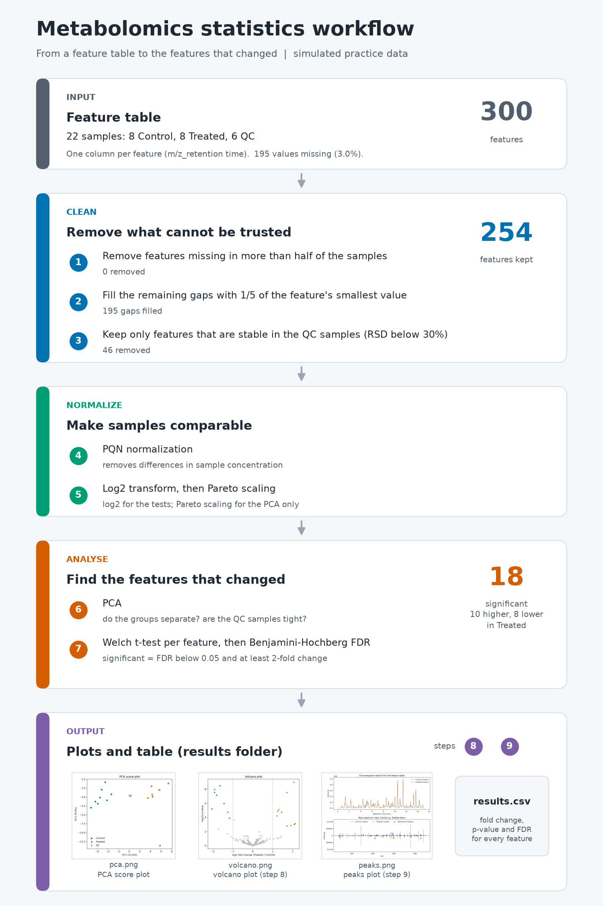
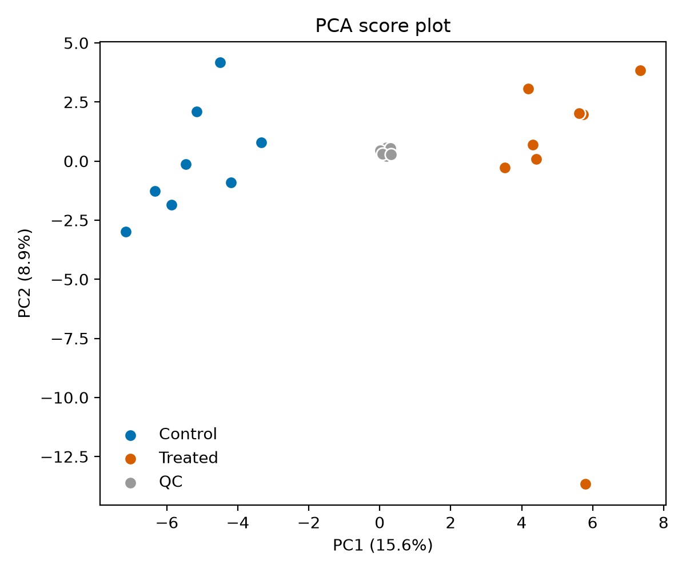
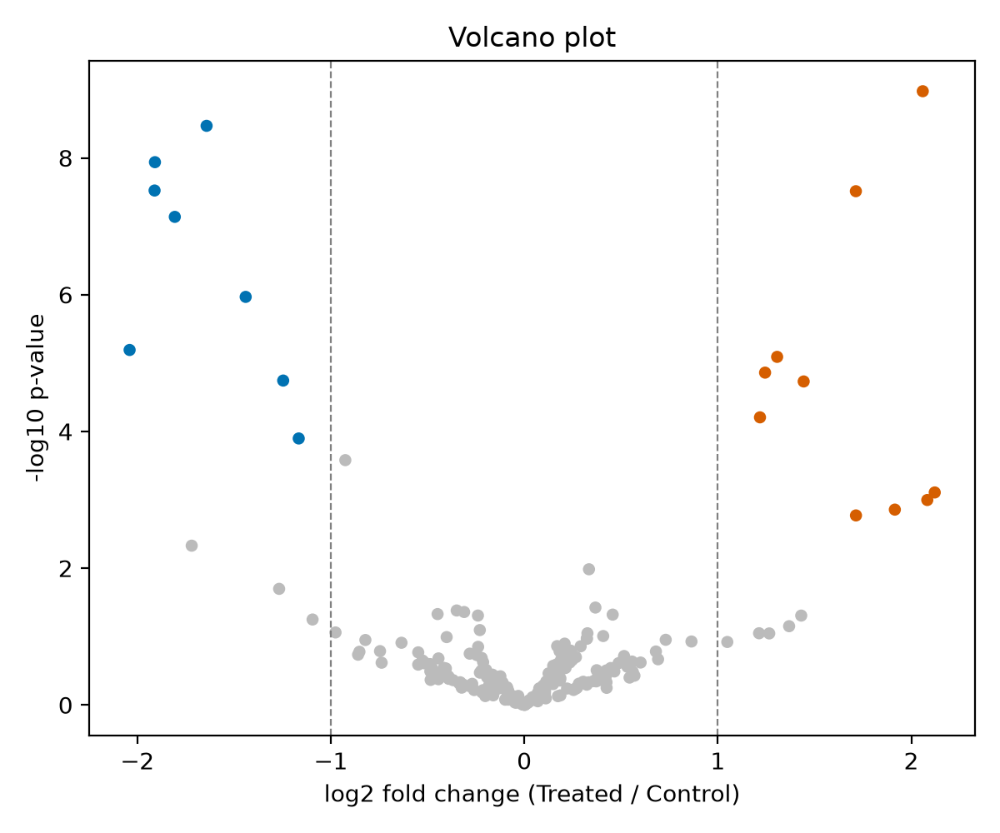
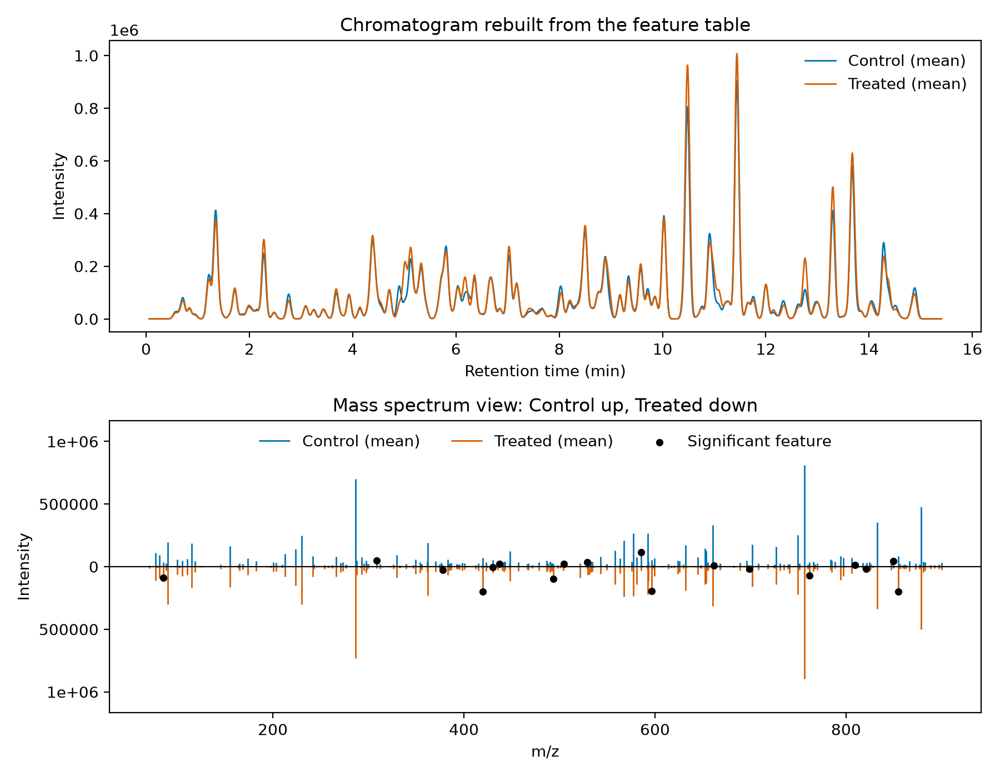

# Results explained, step by step

This file walks through what the pipeline did and what each result means.
It is written for a reader who is new to metabolomics data analysis.

**Important:** the data are simulated practice data, not real samples.
The data were built with 30 truly changed features hidden inside. That lets us
check the pipeline against a known answer at the end.

## The short version

- The pipeline compared 8 Control samples with 8 Treated samples.
- It started with 300 features and tested 254 of them.
- It found **18 features that differ** between the groups: 10 higher in
  Treated and 8 lower.
- All 18 are real. There were no false alarms.
- It missed 12 of the 30 real changes. The cause is the way missing values
  are filled in.

## The workflow in one picture

Read it from top to bottom. Each coloured box is one stage, and the numbered
circles are the steps explained in Part 3. The large numbers on the right
show how many features are left after each stage: 300 at the start, 254
after cleaning, and 18 significant at the end.

## A few words you need first

| Word | Meaning |
|---|---|
| Feature | One signal from the instrument, named by its m/z and retention time, for example `493.7853_13.72`. A feature is a candidate metabolite. |
| Intensity | How big the signal is. A bigger signal means more of that compound. |
| QC sample | A quality-control sample. It is a mix of all samples, measured many times. Because every QC is the same liquid, any difference between QCs is measurement error. |
| Fold change | How many times higher or lower a feature is in Treated compared with Control. |
| log2 fold change | Fold change on a log scale. +1 means doubled, -1 means halved, 0 means no change. |
| p-value | The chance of seeing a difference this big if there is no real difference. Small is strong evidence. |
| FDR (q-value) | A p-value corrected for doing many tests at once. |

## Part 1. The m/z calculator

**What is happening:** a mass spectrometer only detects charged particles
(ions). So each metabolite appears as one or more ions, called adducts. For
example, glucose with an extra proton is written `[M+H]+`. The script adds or
removes the mass of the charged particle to get the m/z the instrument shows.

**Result:** expected m/z values for five metabolites.

| Metabolite | Neutral mass | [M+H]+ | [M+Na]+ | [M+K]+ | [M+NH4]+ | [M-H]- |
|---|---|---|---|---|---|---|
| Glucose | 180.0634 | 181.0707 | 203.0526 | 219.0265 | 198.0972 | 179.0561 |
| Phenylalanine | 165.0790 | 166.0863 | 188.0682 | 204.0421 | 183.1128 | 164.0717 |
| Lactate | 90.0317 | 91.0390 | 113.0209 | 128.9949 | 108.0655 | 89.0244 |
| Citrate | 192.0270 | 193.0343 | 215.0162 | 230.9902 | 210.0608 | 191.0197 |
| Glutamine | 146.0691 | 147.0764 | 169.0584 | 185.0323 | 164.1030 | 145.0619 |

The script then works backwards. Given a measured m/z, it looks for a
metabolite and adduct that fit within 5 ppm (parts per million).

| Measured m/z | Best match | Error |
|---|---|---|
| 179.0560 | Glucose, [M-H]- | -0.63 ppm |
| 166.0864 | Phenylalanine, [M+H]+ | +0.87 ppm |
| 203.0530 | Glucose, [M+Na]+ | +1.94 ppm |

**What it means:** all three peaks match a known metabolite with a very small
error. Note that one metabolite gives several peaks. Glucose appears here both
as `[M-H]-` and as `[M+Na]+`. This is why a real data set has many more
features than metabolites.

**Caution:** a mass match alone is a weak identification. Different compounds
can have the same mass. Real identification also needs retention time and an
MS/MS spectrum.

## Part 2. The practice data

**What is happening:** `make_example_data.py` builds a feature table that
looks like real LC-MS output.

| Property | Value |
|---|---|
| Samples | 22 (8 Control, 8 Treated, 6 QC) |
| Features | 300 |
| Truly changed features | 30 (15 up, 15 down, each 2 to 4 times) |
| Unchanged features | 270 |
| Missing values | 195 of 6,600 values (3.0%) |
| Sample concentration | varies on purpose between samples (0.7x to 1.3x) |

Two problems of real data are included on purpose: missing values, and samples
that are more or less concentrated than others. The analysis must deal with
both.

## Part 3. The analysis, step by step

### Step 1. Remove features that are mostly missing

**What is happening:** a feature that is absent in more than half of the
samples cannot be tested in a fair way, so it is removed.

**Result:** 0 features removed. 150 features had at least one gap, but the
worst feature was missing in only 23% of samples.

### Step 2. Fill the remaining gaps

**What is happening:** the statistics cannot work with empty cells. A gap in
mass spectrometry data usually means "too low to detect", so each gap is
filled with a small number: one fifth of the smallest value of that feature.

**Result:** all 195 gaps were filled.

**What it means:** this is simple, but the fill-in value is very low. It has
side effects, which show up in Step 3 and in Part 4.

### Step 3. Keep only features that are stable in the QC samples

**What is happening:** every QC sample is the same liquid. A trustworthy
feature should give almost the same intensity in all six. The spread is
measured as RSD (relative standard deviation). Features with an RSD of 30% or
more are removed.

**Result:**

| | Features | RSD in QC |
|---|---|---|
| Kept | 254 | below 30% (middle value 19%) |
| Removed | 46 | 44% or higher |

**What it means:** all 46 removed features had a gap in one of the QC samples.
The low fill-in value from Step 2 made them look unstable. So in this run the
filter did not catch noisy features. It caught features with a missing QC
value. In real data the same filter also removes truly noisy features.

### Step 4. PQN normalization

**What is happening:** some samples are more concentrated than others. That
raises or lowers all their features together, which is not biology. PQN
estimates one dilution factor per sample and divides it out.

**Result:** the estimated factors ran from 0.63 (sample T8, the most dilute)
to 1.20 (sample QC4, the most concentrated).

**What it means:** before this step, sample QC4 looked almost twice as
"strong" as sample T8 for no biological reason. After this step all samples
are on the same scale and can be compared fairly.

### Step 5. Log transform and Pareto scaling

**What is happening:**

- Raw intensities are very uneven: a few huge peaks and many small ones.
  Taking log2 makes them bell-shaped, which the t-test expects. It also turns
  "2 times higher" into a simple "+1".
- Pareto scaling is used only for the PCA. It stops the largest peaks from
  dominating the picture.

**Result:** no features are removed here. The numbers are only reshaped.

### Step 6. PCA

**What is happening:** PCA squeezes all 254 features into two axes that show
the biggest differences between samples. It does not know which sample belongs
to which group, so it is an honest first look.

**How to read it:** each dot is one sample. Dots close together are similar
samples. The percentage on each axis is how much of the total variation that
axis shows.

**What it means:**

- **Control (blue) and Treated (orange) are far apart, left and right.**
  The treatment is the largest pattern in the data (PC1, 15.6%).
- **The six QC samples (grey) sit on top of each other.** The measurement was
  stable. QCs also sit in the middle, as expected for a mix of both groups.
- **One Treated sample, T3, is far below the others** (PC2, 8.9%). T3 has more
  filled-in gaps than any other sample (14), which is the likely reason, but
  this was not proven. In a real study, such a sample should be checked before
  it is kept.

### Step 7. Statistical tests

**What is happening:** each feature gets its own Welch t-test, Treated against
Control. QC samples are not used in the test.

Then comes a correction. With 254 tests, some will look significant by pure
luck. FDR correction (Benjamini-Hochberg) accounts for this.

**Result:**

| Rule | Features passing |
|---|---|
| Raw p-value below 0.05 | 29 |
| FDR below 0.05 | 19 |
| FDR below 0.05 **and** at least 2-fold change | **18** |

**What it means:**

- Of the 29 features with a raw p-value below 0.05, 7 were unchanged features
  that passed by luck. After FDR correction, none of those 7 remain. This is
  why the correction is needed.
- One feature (`548.6242_1.18`) passed the FDR rule but changed slightly less
  than 2-fold, so it is not counted.

### Step 8. Volcano plot

**How to read it:** each dot is one feature.

- Left to right: how much it changed. Left of the first dashed line is "at
  least halved in Treated". Right of the second dashed line is "at least
  doubled in Treated".
- Bottom to top: how strong the evidence is. Higher is stronger.
- Orange dots are significantly higher in Treated. Blue dots are significantly
  lower. Grey dots are not significant.

**What it means:** most features form a grey cloud at the bottom centre. They
do not change. The 18 coloured dots in the top corners are the features of
interest. Some grey dots lie outside the dashed lines: they changed a lot on
average, but the evidence is too weak to trust.

### Step 9. Peaks plot

**What is happening:** the plots above show statistics. This one shows the
peaks themselves, in the two views an LC-MS instrument gives. Each feature
name holds its m/z and its retention time, so the script knows where to draw
every peak. The heights are the group mean intensities after normalization
(Step 4).

**How to read it:**

- **Top, chromatogram view:** signal against retention time. Blue is the
  Control mean, orange is the Treated mean.
- **Bottom, mass spectrum view:** one stick per feature at its m/z. Control
  sticks point up and Treated sticks point down. A stick that is much longer
  on one side changed between the groups. Black dots mark the 18 significant
  features, on the side where they are higher.

**Caution:** the top panel is rebuilt from the feature table. It is not the
raw trace from the instrument. A feature table keeps one number per peak (its
size) and not its shape, so every peak is drawn as a bell curve of the same
width. The two panels also use the same 254 features; features at the same
retention time add up in the top panel.

**What it means:**

- The blue and orange lines lie almost on top of each other. Most peaks do
  not change, and the normalization put all samples on the same scale.
- A few very large peaks dominate the picture. The six largest peaks are all
  unchanged features. Half of the features are below 25,000, which is too
  small to see next to a peak of 900,000.
- The significant features are mostly small or medium peaks. The largest one
  (`854.7977_12.76`) reaches about 200,000 in Treated. So the features that
  matter are hard to find by eye, and the tallest peaks are not the
  interesting ones. This is why the statistical tests are needed.

### The 18 significant features

| # | Feature (m/z_RT) | log2 fold change | Fold change | Direction in Treated | FDR |
|---|---|---|---|---|---|
| 1 | 493.7853_13.72 | +2.06 | 4.2x | higher | 2.7e-07 |
| 2 | 437.0739_14.09 | -1.64 | 3.1x | lower | 4.3e-07 |
| 3 | 809.1796_14.29 | -1.91 | 3.8x | lower | 9.8e-07 |
| 4 | 699.1364_7.42 | +1.71 | 3.3x | higher | 1.6e-06 |
| 5 | 585.2138_4.9 | -1.91 | 3.8x | lower | 1.6e-06 |
| 6 | 849.713_8.0 | -1.81 | 3.5x | lower | 3.1e-06 |
| 7 | 661.8505_13.01 | -1.44 | 2.7x | lower | 3.9e-05 |
| 8 | 308.5574_6.25 | -2.04 | 4.1x | lower | 2.0e-04 |
| 9 | 821.2222_11.42 | +1.31 | 2.5x | higher | 2.3e-04 |
| 10 | 854.7977_12.76 | +1.24 | 2.4x | higher | 3.5e-04 |
| 11 | 504.405_12.62 | -1.25 | 2.4x | lower | 3.9e-04 |
| 12 | 419.7163_10.51 | +1.44 | 2.7x | higher | 3.9e-04 |
| 13 | 85.2917_11.1 | +1.22 | 2.3x | higher | 1.2e-03 |
| 14 | 529.1433_12.32 | -1.17 | 2.2x | lower | 2.3e-03 |
| 15 | 596.3856_5.01 | +2.12 | 4.3x | higher | 1.2e-02 |
| 16 | 761.7801_8.96 | +2.08 | 4.2x | higher | 1.5e-02 |
| 17 | 430.4796_3.96 | +1.91 | 3.8x | higher | 2.0e-02 |
| 18 | 378.0517_4.92 | +1.71 | 3.3x | higher | 2.3e-02 |

The feature names are random labels made by the simulation. They are not real
metabolites. In a real study, the next step would be to identify each one.

All 254 tested features are in `results/results.csv`.

## Part 4. Checking against the known answer

Because the data are simulated, we know which 30 features truly changed.

| | Count |
|---|---|
| Truly changed features in the data | 30 |
| Found by the pipeline | **18** (10 up, 8 down) |
| False alarms | **0** |
| Missed | 12 |

**What it means:** the pipeline is careful. Everything it reports is real, but
it does not find everything.

**Why 12 were missed:**

| Reason | Count |
|---|---|
| Removed in Step 3, because of a gap in a QC sample | 4 |
| Tested, but had a gap in a Control or Treated sample. The low fill-in value added spread, which weakened the test. | 7 |
| Tested, no gaps, but the measured change was just under 2-fold (log2 fold change -0.92) | 1 |

So 11 of the 12 misses trace back to the fill-in method of Step 2. A gentler
method (for example half of the smallest value, or k-nearest neighbours) would
probably recover some of them. That was not tested here.

## What these results do not tell you

- Nothing about real biology. The data are made up.
- Nothing about which metabolites changed. The feature names are random.

## How to reproduce these numbers

Run the four scripts as shown under "How to run it" in [README.md](README.md).
The simulation uses a fixed random seed, so every run gives the same table and
the same results.
